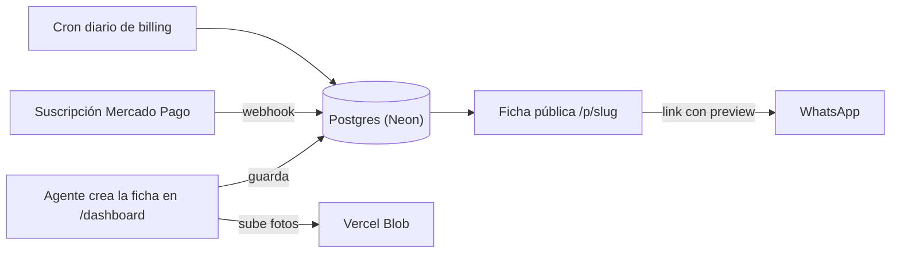

<p align="center">
  
</p>

<h1 align="center">Conexory</h1>

<p align="center">
  Fichas de propiedades con link propio, listas para compartir por WhatsApp. Para agentes inmobiliarios independientes en Colombia.
</p>

<p align="center">
  <a href="https://conexory.com"><strong>Sitio en producción</strong></a> ·
  <a href="https://github.com/LEstebanR/conexory/issues">Issues</a> ·
  <a href="#correr-en-local">Correr en local</a> ·
  <a href="#contribuir">Contribuir</a>
</p>

<p align="center">
  <a href="https://github.com/LEstebanR/conexory/actions/workflows/ci.yml"></a>
</p>

---

## Estado

> **En producción en [conexory.com](https://conexory.com).** El registro es gratis; el plan Pro se cobra mensual con Mercado Pago. El trabajo nuevo se registra en [GitHub Issues](https://github.com/LEstebanR/conexory/issues); los issues anteriores (`LES-*`) viven en Linear.

## Qué es

Un agente inmobiliario independiente suele mostrar sus propiedades mandando fotos sueltas y texto por WhatsApp. Conexory le da a cada propiedad una ficha pública con su propio link, que al compartirse muestra una preview enriquecida (imagen, título y precio). El flujo completo, de crear la ficha a compartirla, toma menos de 60 segundos y no exige saber nada de tecnología.

- **Ficha pública** en `conexory.com/p/{slug}`, sin login, con fotos, precio, características y contacto del agente.
- **Perfil público del agente** en `conexory.com/agente/{slug}`, con sus propiedades publicadas.
- **Panel del agente** en `/dashboard`: crear, editar, publicar y compartir propiedades, con métricas por propiedad.
- **Mensaje de WhatsApp con IA** (Gemini Flash) para presentar cada propiedad.

**Planes:** Free, Pro (suscripción mensual) y Personalizado (equipos e inmobiliarias, por contacto). Los límites de propiedades y fotos de cada plan viven en [`lib/plans.ts`](./lib/plans.ts), la única fuente de verdad.

## Cómo funciona



1. **Crear la ficha:** tipo, precio, ubicación, características y fotos. Las fotos se suben a Vercel Blob.
2. **Compartir:** cada propiedad tiene un link único; la imagen OG genera la preview en WhatsApp.
3. **Cobrar el plan Pro:** Mercado Pago cobra la suscripción recurrente y avisa los resultados por webhook (`/api/webhooks/mercadopago`). Un cron diario (`/api/cron/billing`) manda recordatorios de renovación y baja a Free las cuentas canceladas o rechazadas.

## Stack

| Capa | Elección | Estado |
| --- | --- | --- |
| Framework | [Next.js 16](https://nextjs.org) (App Router, Turbopack en dev), React 19, TypeScript | ✅ En uso |
| Estilos | Tailwind CSS 4, sistema monocromo (ver [`DESIGN.md`](./DESIGN.md)), Radix UI + Lucide | ✅ En uso |
| Base de datos | [Neon](https://neon.tech) Postgres con Prisma 5 y migraciones en el repo | ✅ En uso |
| Auth | [better-auth](https://www.better-auth.com): email/contraseña + Google OAuth | ✅ En uso |
| Almacenamiento | [Vercel Blob](https://vercel.com/docs/storage/vercel-blob) para las fotos | ✅ En uso |
| Pagos | [Mercado Pago](https://www.mercadopago.com.co): suscripción recurrente del plan Pro, credenciales de prueba en previews | ✅ En uso |
| Emails | [Resend](https://resend.com) + React Email (plantillas en `emails/`) | ✅ En uso |
| IA | Gemini Flash (Google AI Studio) para el mensaje de WhatsApp | ✅ En uso |
| Tests | Bun test (unitarios, con umbral de cobertura) + [Playwright](https://playwright.dev) (E2E) | ✅ En uso |
| CI | GitHub Actions: typecheck, lint, test, cobertura y E2E como checks separados | ✅ En uso |
| Hosting | [Vercel](https://vercel.com): producción + un preview por PR | ✅ En uso |
| Package manager | [Bun](https://bun.sh) | ✅ En uso |

## Estructura del proyecto

```
app/
  page.tsx              Landing pública (redirige a /dashboard si hay sesión)
  precios/, blog/, contacto/, privacy/, terms/, cookies/   Páginas de marketing y legales
  propiedades/[ciudad]/ Índice público de propiedades por ciudad (SEO)
  p/[slug]/             Ficha pública de la propiedad (sin login)
  agente/[slug]/        Perfil público del agente
  login/, register/, forgot-password/, reset-password/     Auth (Server Actions)
  dashboard/            Panel del agente: propiedades, ajustes y upgrade a Pro
  admin/                Panel interno: usuarios, referidos y feedback
  api/
    auth/[...all]/      Handler de better-auth
    upload/             Subida de fotos a Vercel Blob
    webhooks/mercadopago/  Webhook de Mercado Pago (estado de la suscripción)
    cron/billing/       Cron diario de billing (programado en vercel.json)
components/
  ui/                   Componentes atómicos (Button, Input, Badge)
emails/                 Plantillas de React Email (bienvenida, verificación, pagos)
lib/
  auth.ts               Config de better-auth (servidor)
  plans.ts              Límites por plan
  prisma.ts             Singleton de PrismaClient
  mercadopago.ts        Cliente de Mercado Pago
  subscription.ts       Estado de la suscripción y bajada a Free
  email.ts              Envío de emails con Resend
  urls.ts               getAppUrl(): URL pública canónica
content/blog/           Posts en Markdown
e2e/                    Tests E2E de Playwright
prisma/
  schema.prisma         Esquema de la base de datos
  migrations/           Migraciones de Prisma
.github/workflows/      CI y validación del nombre de rama
.githooks/pre-push      Corre bun lint antes de cada push
AGENTS.md               Reglas y convenciones del proyecto (para agentes de IA y humanos)
DESIGN.md               Sistema de diseño
```

## Correr en local

Requiere [Bun](https://bun.sh) y una base de datos Postgres (una branch de [Neon](https://neon.tech) o Postgres local).

```bash
git clone https://github.com/LEstebanR/conexory.git
cd conexory
bun install
cp .env.example .env          # completar los valores (ver abajo)
bunx prisma migrate dev
bun dev
```

Abrir http://localhost:3000.

Para Google OAuth, agregar como URI de redirección autorizada `http://localhost:3000/api/auth/callback/google`.

### Scripts

| Comando | Qué hace |
| --- | --- |
| `bun dev` | Servidor de desarrollo (corre `prisma generate` antes) |
| `bun run build` | `prisma migrate deploy` + `next build`. Es lo que corre Vercel en cada deploy |
| `bun run start` | Sirve el build de producción |
| `bun typecheck` | `tsc --noEmit` |
| `bun lint` | ESLint (también corre en el hook `pre-push`) |
| `bun run test` | Tests unitarios con Bun test (sin E2E) |
| `bun run coverage` | Tests unitarios con el umbral de cobertura que exige CI (`bunfig.toml`) |
| `bun run test:e2e` | Tests E2E con Playwright. Reutiliza el `bun dev` que esté corriendo en el puerto 3000 |
| `bunx prisma migrate dev` | Crea y aplica una migración nueva. Nunca `prisma db push` |
| `bunx prisma studio` | GUI de la base de datos |

### Variables de entorno

Todas las variables que necesita la app están en [`.env.example`](./.env.example), solo con el nombre y comentarios.

| Variable | Para qué | Preview | Producción | De dónde sale |
| --- | --- | --- | --- | --- |
| `DATABASE_URL`, `DIRECT_URL` | Postgres (pooled para la app, directa para migraciones) | Base de datos de dev | Base de datos de producción | Neon → Connect |
| `BETTER_AUTH_SECRET` | Firma de sesiones | Aleatorio | Aleatorio | `openssl rand -hex 32` |
| `BLOB_READ_WRITE_TOKEN` | Subida de fotos | Token del store | Token del store | Vercel → Storage → Blob |
| `GOOGLE_CLIENT_ID`, `GOOGLE_CLIENT_SECRET` | Google OAuth | Cliente OAuth | Cliente OAuth | [Google Cloud Console](https://console.cloud.google.com) |
| `MERCADOPAGO_ACCESS_TOKEN` | Suscripciones del plan Pro | Credenciales de prueba | Credenciales de producción | Mercado Pago → Tus integraciones |
| `NEXT_PUBLIC_MERCADOPAGO_PUBLIC_KEY` | Tokenizar la tarjeta en el cliente (se expone a propósito) | De prueba | De producción | La pareja del access token del mismo entorno |
| `MERCADOPAGO_WEBHOOK_SECRET` | Validar la firma de los webhooks | De prueba | De producción | Mercado Pago → Webhooks |
| `RESEND_API_KEY` | Envío de emails | API key | API key | Resend → API Keys. El remitente debe ser de `conexory.com` |
| `CRON_SECRET` | Autenticar el cron de billing | Aleatorio | Aleatorio | `openssl rand -hex 32` |
| `GOOGLE_AI_API_KEY` | Mensaje de WhatsApp con IA. Si falta, la acción devuelve un error amigable | API key | API key | [aistudio.google.com/apikey](https://aistudio.google.com/apikey) (gratis) |
| `NEXT_PUBLIC_USECHANGELOG_WIDGET_KEY` | Widget "Novedades" del dashboard | Key pública | Key pública | UseChangelog → Settings → Widget |
| `APP_URL` | Opcional: forzar la URL pública canónica (dominio custom) | Vacía | Vacía | Tú |
| `BETTER_AUTH_URL` | Opcional: forzar la URL base de auth | Vacía | Vacía | Tú |
| `VERCEL_URL`, `VERCEL_PROJECT_PRODUCTION_URL` | Derivar la URL de la app y de auth | Las pone Vercel | Las pone Vercel | Nunca configurarlas a mano |

> La URL pública de la app **no** se configura con una variable `NEXT_PUBLIC_*`: se resuelve en runtime con `getAppUrl()` (`lib/urls.ts`).

## Deploy

- **Producción:** https://conexory.com, en Vercel. Solo el entorno *Production* apunta a la base de datos real.
- **Previews:** cada PR tiene su preview en Vercel. *Preview* y *Development* apuntan a una base de datos de dev aparte, así que una migración en un preview nunca toca producción.
- **Migraciones:** `bun run build` corre `prisma migrate deploy` antes de `next build`, así que las migraciones pendientes se aplican solas en cada deploy.
- **Billing:** Mercado Pago manda los webhooks a `/api/webhooks/mercadopago`. El cron `/api/cron/billing` corre todos los días a las 09:00 UTC (`vercel.json`) y se autentica con `CRON_SECRET`.
- **CI:** [GitHub Actions](.github/workflows/ci.yml) corre typecheck, lint, test, cobertura y E2E (contra un Postgres efímero) en cada PR. [`branch-name.yml`](.github/workflows/branch-name.yml) valida el nombre de la rama.

## Contribuir

- **Un issue, una rama, un PR**, desde `main` actualizado.
- **Ramas:** el formato depende de dónde vive el issue. Tipos válidos: `feat`, `fix`, `refactor`, `chore`, `docs`.

  ```
  {type}/LES-{número}-{descripción}     # issue en Linear
  {type}/{descripción}                  # issue en GitHub (sin número)
  ```

  Por ejemplo `feat/LES-149-plan-pro-subscriptions` o `chore/migrate-mercadopago`.
- **PRs:** título `{type}: descripción en imperativo`. La descripción sigue [`.github/pull_request_template.md`](.github/pull_request_template.md) y lleva `Closes #{número}` si el issue está en GitHub, para que se cierre al mergear.
- **Idioma:** la UI y los textos para el usuario van en español; los comentarios de código, en inglés.
- **Nunca subir secretos** ni archivos `.env*` (salvo `.env.example`).

### Trabajar con agentes de IA

[`AGENTS.md`](AGENTS.md) es la fuente de verdad de las reglas y convenciones del proyecto, y [`CLAUDE.md`](CLAUDE.md) lo importa. El repo trae sus propios comandos en `.claude/commands/`:

| Comando | Para qué |
| --- | --- |
| `/create-gh-issue` | Crear un issue de GitHub bien formado, con la plantilla y los labels del proyecto |
| `/dev-issue` | El proceso completo para desarrollar un issue: plan, implementación, revisión y PR |
| `/review-conexory` | Revisar un diff contra las reglas propias de Conexory |
| `/create-pr` | Commits, los mismos checks que CI en local, push y PR con la descripción armada |
| `/db` | Migraciones de Prisma, estado de la base de datos y branches de Neon |
| `/retrospective` | Extraer lo aprendido en una sesión y actualizar la memoria del proyecto |

En `.claude/skills/` hay además skills de terceros (Next.js, Prisma, Neon, better-auth, Tailwind, Zod, entre otras).
